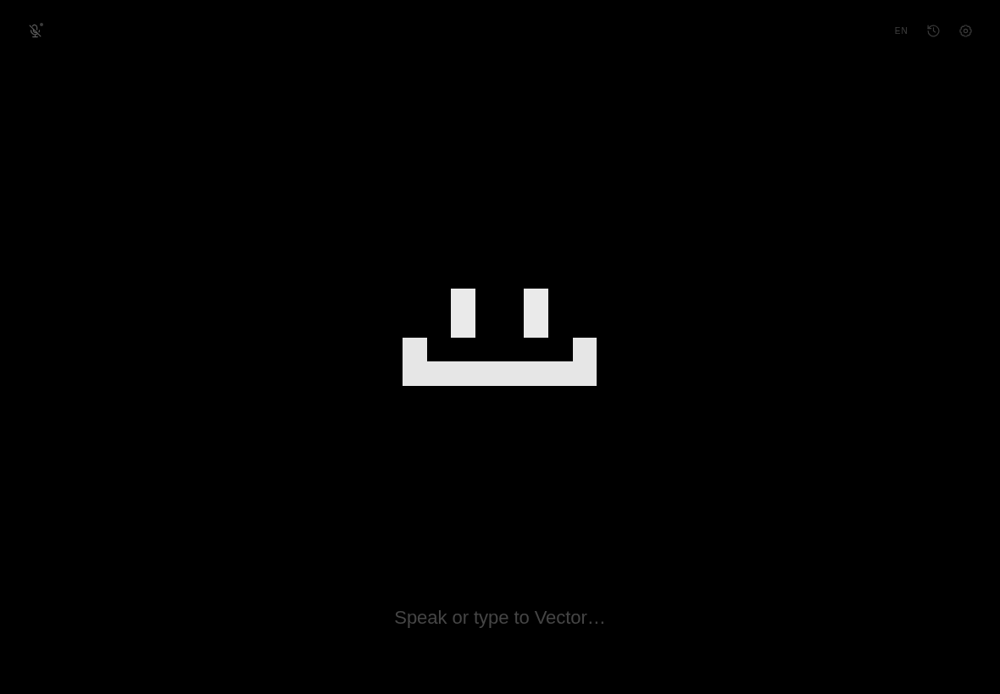

# Vector 2

**English** · [Русский](README.ru.md)

**Vector** is a local voice companion with a tiny animated pixel face. It listens through your microphone, transcribes speech locally with Whisper, streams replies from a local LLM through Ollama, and reacts with facial animations. It **never speaks aloud** — no text-to-speech, no audio replies. Vector types.

The interface is deliberately one screen: a centered face, one line of text at the bottom, and a few almost-invisible controls in the corners. Three character packs are included: **Vector** (the original **12×12** sprite), **MOSS** (a 14×14 CRT terminal), and **Lumen** (a detailed 16×16 face). You can also build a custom pack from any skin and your own system prompt.



<sub>The default stage: original 12×12 face, one line, no dashboard.</sub>

## Design rules

- **One stage, one face, one line.** No persistent chat panel, HUD, meters, status pills, or toolbars.
- **The character is the interface.** State is expressed by the face: listening, thinking, typing, sleeping, emoting.
- **Character packs, not a costume menu.** A pack owns the name, face, palette, and persona prompt. Vector keeps the original 12×12 silhouette; MOSS and Lumen are distinct characters, not filters.
- **Calm by default.** Flat black, white face, amber accent, thin borders. Particles, hearts, sparkles, and glow are off unless enabled.
- **Progressive disclosure.** Settings, history, and the debug console appear only when asked for.
- **Local and private.** Audio and text stay on this machine. Whisper, Silero VAD, and Ollama run locally. Only the one-time model download touches the network.
- **No TTS.** The only sounds are tiny optional synthesized UI blips (mic, send, receive, error) — never speech.

## What you need

You do not need to be a programmer. You will copy a few commands into a terminal, and the setup wizard will do the rest.

| What | Why you need it | How to check |
| --- | --- | --- |
| **Python 3.11–3.13** (3.12 recommended) | Runs Vector's local server | `python3 --version` on macOS/Linux, `py --version` on Windows |
| **Ollama** | Runs the language model on your computer | `ollama --version` |
| **About 4 GB of free disk space** | ~0.5 GB speech model + ~2 GB language model + Python packages | — |
| **A microphone** | Vector listens to you | — |
| **Chrome, Chromium, Brave, or Edge** | Optional: opens Vector in a clean app window | — |

Python 3.14 may not yet have ready-made packages for some speech libraries, so install **3.12** if you can choose.

You do **not** need PortAudio or any native audio library: the browser captures the microphone and sends 16 kHz PCM to the local server.

---

## Installation, step by step

The whole installation takes about **10–20 minutes**, mostly waiting for downloads. Do the steps in order. If a command is not recognised, see [If installation goes wrong](#if-installation-goes-wrong).

### Step 1 — Install Python 3.12

**Windows**

1. Open <https://www.python.org/downloads/>.
2. Download **Python 3.12.x** for Windows.
3. Run the installer. On the first screen, tick **“Add python.exe to PATH”**, then click **Install Now**.
4. Open a terminal: press `Win+R`, type `cmd`, press Enter.
5. Check the version:

   ```bat
   py -3.12 --version
   ```

   You should see something like `Python 3.12.10`. If you see Python 3.14 or “not found”, install 3.12 from the link above.

**macOS**

1. Download the macOS installer from <https://www.python.org/downloads/macos/> and run it, **or** use Homebrew:

   ```bash
   brew install python@3.12
   ```

2. Open **Terminal** (Applications → Utilities → Terminal) and check:

   ```bash
   python3.12 --version
   ```

**Linux (Ubuntu / Debian)**

```bash
sudo apt update
sudo apt install python3.12 python3.12-venv
python3.12 --version
```

On Fedora use `sudo dnf install python3.12`. Package names may differ slightly on other distributions.

> **Checkpoint:** the version command prints `Python 3.12.x` (3.11 or 3.13 is also fine).

### Step 2 — Install and start Ollama

1. Download Ollama from <https://ollama.com/download> and install it.
   - **Windows / macOS:** run the installer and open the Ollama app once. It keeps running in the background.
   - **Linux:** follow the install command on the same page, or use:

     ```bash
     curl -fsSL https://ollama.com/install.sh | sh
     ```

2. Close and reopen your terminal, then check:

   ```bash
   ollama --version
   ```

3. Make sure Ollama is running. On Windows/macOS the Ollama icon should be in the tray/menu bar. On Linux, if the command below fails, start it manually:

   ```bash
   ollama serve
   ```

   Leave that terminal window open while using Vector.

> **Checkpoint:** `ollama --version` prints a version, and <http://127.0.0.1:11434> responds (it is normal if the page itself is empty or says “Ollama is running”).

### Step 3 — Download Vector

You need the project folder on your computer. Choose **one** option.

**Option A — with Git (recommended if you have it)**

```bash
git clone https://github.com/badretd/vector-beta.git
cd vector-beta
```

**Option B — without Git**

1. Open <https://github.com/badretd/vector-beta>.
2. Click **Code → Download ZIP**.
3. Unpack the archive.
4. Open a terminal **inside the unpacked `vector-beta` folder** (on Windows: open the folder, right-click empty space → “Open in Terminal”; on macOS: right-click the folder → Services → “New Terminal at Folder”).

> **Checkpoint:** the terminal is inside the folder that contains `run.sh`, `requirements.txt`, and the `vector` directory.

### Step 4 — Download the language model

This is the “brain” Vector will talk to. Run:

```bash
ollama pull qwen2.5:3b
```

The download is about **2 GB** and happens only once. A progress bar is shown.

Other good small models:

```bash
ollama pull llama3.2:3b
# or
ollama pull phi3:mini
```

The default is `qwen2.5:3b`; you can change it later in **Settings → Advanced**.

> **Checkpoint:** `ollama list` shows the model you just downloaded.

### Step 5 — Start Vector

**macOS / Linux**

In the project folder, run:

```bash
./run.sh
```

The first launch creates a private Python environment (`.venv`) and installs the dependencies. This takes a few minutes. **Do not close the terminal while it works.**

If you see `Permission denied`, make the script executable once and run it again:

```bash
chmod +x run.sh
./run.sh
```

**Windows**

`run.sh` is a macOS/Linux script, so on Windows use these commands in the project folder (Command Prompt or PowerShell):

```bat
py -3.12 -m venv .venv
.venv\Scripts\activate
pip install -r requirements.txt
python -m vector
```

The first launch installs the dependencies and takes a few minutes. If PowerShell refuses to activate the environment, use **Command Prompt (`cmd`)** instead.

**What should happen:** after a short wait, a terminal banner appears and a browser window opens at <http://127.0.0.1:8765/>. If no window opens, open that address manually in Chrome.

**Manual method** (any OS, if you prefer not to use `run.sh`):

```bash
python3.12 -m venv .venv
source .venv/bin/activate       # Windows: .venv\Scripts\activate
pip install -r requirements.txt
python -m vector
```

To stop Vector, return to the terminal and press `Ctrl+C`. To start it again later, run the same start command — the dependencies are already installed.

### Step 6 — Complete the first-run wizard

On the first launch Vector shows a short setup screen:

1. **Language** — choose English or Русский.
2. **Readiness** — Vector checks three things:
   - **Local LLM** — Ollama is running and reachable;
   - **Speech recognition** — Whisper is loading;
   - **Microphone** — the browser can see an input device.
3. **Who should I be?** — pick **Vector**, **MOSS**, or **Lumen**, or create a **custom pack** with your own name, skin, and system prompt. Then pick a room theme: **Mono**, **Mint**, or **Paper**.

The speech model downloads on first use into `data/models/whisper/`. The default `small` model is about **466 MB**, so the first check may take a few minutes and needs an internet connection. Progress is shown on the readiness screen and in the debug console.

If the LLM check fails and you just want to look around, click **“explore with the offline demo”** — no Ollama is needed for the demo.

When the microphone check is green, allow microphone access in the browser if it asks. Everything is processed locally.

> **Done.** Click a reply to dismiss it, press `F9` or click the background to start listening, and simply talk or type.

### Other launch options

```bash
python -m vector --no-browser          # print the URL only
python -m vector --tab                 # open a normal browser tab
python -m vector --port 9000
python -m vector --demo                # offline demo companion (no Ollama)
python -m vector --data-dir ./profile  # separate settings/history
```

### Updating Vector

```bash
git pull
./run.sh
```

If startup fails after an update, reinstall the dependencies:

```bash
# macOS / Linux
.venv/bin/python -m pip install -r requirements.txt

# Windows
.venv\Scripts\python -m pip install -r requirements.txt
```

## Controls

| Action | Control |
| --- | --- |
| Start / stop microphone | `F9`, or click the background |
| Send typed text | `Enter` |
| New line | `Shift+Enter` |
| Submit buffered speech | `F2` (configurable) |
| Toggle conversation history | `Ctrl+H` |
| Toggle debug console | `Ctrl+Shift+D` |
| Close an overlay / cancel a reply | `Esc` |
| Dismiss a reply | Click the reply |
| Poke Vector | Click the face |
| Resize the character | Scroll |
| Resize the whole UI | `Ctrl+scroll` |

The mode selector disappears at rest. Hover the input area to see `silence · hotkey · auto`, or change it in **Settings → Companion**.

## Turn-taking modes

- **Silence** (default) — Silero VAD detects speech and end-of-speech. After `asr.silence_ms` of silence (default 900 ms), the utterance is transcribed and sent.
- **Hotkey** — speech is transcribed and buffered. Nothing is sent until you press `F2` (or Enter with an empty input).
- **Auto** — each utterance is scored by an explainable judge (questions, direct address, greetings, requests, a pending question from Vector, custom keywords). If the score reaches the threshold (default 3), the buffer is sent. Otherwise it is held, and a force-send timer eventually sends it.

Every score and reason is visible in the debug console.

## The emotion protocol

Vector's system prompt asks the model to begin sentences with one tag from:

`[neutral] [happy] [excited] [curious] [thinking] [sad] [surprised] [confused] [sleepy] [angry] [embarrassed] [love] [proud] [scared] [bored] [wink] [laugh] [glitch]`

Examples:

```text
[curious] What is rain made of? [happy] I want to taste it.
```

The parser accepts `[happy]`, `<happy>`, `*happy*`, `(happy)`, `[emotion: happy]`, and aliases such as `joy`, `laughs`, `shy`, `wow`, `error`. It is a streaming parser, so a tag split across two LLM chunks never leaks into the chat. If the model forgets tags, a small sentiment/lexicon fallback picks an emotion.

The face also has internal states (`listening`, `thinking`, `speaking`, `sleeping`) that are not requested from the model.

## Character packs

A character pack owns the name, the face, the default palette, and the persona prompt. Three packs are built in:

| Pack | Skin | Character |
| --- | --- | --- |
| **Vector** | 12×12 original | The playful, curious little program from the original sprite |
| **MOSS** | 14×14 CRT | A creaky terminal with square phosphor eyes, a dim bezel, and a status LED |
| **Lumen** | 16×16 detailed | A softer face with brows, cheeks, constellation freckles, and a gentle smile |

All three use the same emotion state machine and nearest-neighbour pixel rendering. They support:

- Random blinking, occasional double-blinks
- Pointer-following eyes and idle saccades
- Breathing and a very small bob
- Mouth movement while a reply streams
- Smile, frown, side-mouth, open-mouth and O-mouth expressions
- Sleeping (closed eyes, slower breathing)
- Smooth transitions between expressions

A **custom pack** can reuse any of the three skins with your own name and base system prompt. The app still appends the emotion-tag and style rules, because those are what make the face respond.

Existing users are shown the pack chooser once after upgrading, so an old preset is never silently lost. `terminal` maps to MOSS, `oracle` to Lumen, and the removed `kitten`/`gremlin` presets fall back to Vector.

The **Face Lab** (`Settings → Character → Open face lab`, or `/lab.html`) shows every skin, emotion, state, palette, size, and motion toggle. It is the fastest way to tune the character.

The lab also exposes **smart separation** with `inset`, `gap`, `trim`, and `off` modes plus a collision overlay. The default `inset` mode pulls the offending mouth edge back by about two screen pixels, so it never overlaps the eyes; the eyes keep their full pixels. `gap` and `trim` remain available for comparison.

## Settings

Everything lives in `data/settings.json` and saves automatically.

- **Voice** — interface language, Whisper model, recognition language, microphone, silence before send, mic sensitivity, live partials.
- **Character** — character pack, custom pack fields, room theme, face palette, size, smart separation, pointer following, blink, breathing, particles, antenna, reduced motion, colors, face lab.
- **Companion** — name override, reply language, reply length, turn-taking mode, idle nudges, mood, memory facts.
- **Advanced** — Ollama URL and model, temperature, context, max tokens, ASR device/precision, log level, offline demo, import/export/reset.

Themes are **Mono** (default), **Mint**, and **Paper**. The face palette is independent, so you can put a white face in a mint room or a dark face in a paper room.

## Architecture

```
vector-beta/
├── vector/                 Python backend
│   ├── __main__.py         launcher, browser window, CLI flags
│   ├── server.py           FastAPI, WebSocket hub, REST API, logging
│   ├── config.py           defaults, validation, atomic settings store
│   ├── characters.py       built-in packs, skins, legacy migration
│   ├── asr.py              faster-whisper, Silero VAD, endpointing, partials
│   ├── dialogue.py         turn manager, auto-send judge, memory, mood
│   ├── llm.py              async Ollama streaming client + offline demo
│   ├── emotions.py         emotion registry, streaming tag parser
│   ├── prompts.py          compact persona prompts
│   └── ...
├── web/                    no-build frontend
│   ├── index.html          one stage
│   ├── lab.html            face lab
│   ├── css/app.css         mono/mint/paper, drawers, debug
│   ├── js/main.js          state, socket, shortcuts, onboarding
│   ├── js/character.js     procedural pixel character + animation
│   ├── js/audio.js         mic capture + 16 kHz resampler
│   ├── js/pcm-worklet.js   AudioWorklet resampler
│   ├── js/settings.js      generated settings drawer
│   ├── js/debug.js         debug console
│   ├── js/i18n.js          EN/RU
│   └── locales/
├── examples/               original 12×12 reference sprites
├── tests/                  pytest suite
├── requirements.txt
├── run.sh
└── data/                   generated at runtime
```

Audio path: browser `getUserMedia` → AudioWorklet resamples to 16 kHz mono float32 → WebSocket binary → Silero VAD endpointing → faster-whisper → turn manager → Ollama NDJSON stream → emotion parser → WebSocket events → face + chat.

### Performance notes

- Per-client outgoing queues: one slow browser cannot stall the turn manager.
- Assistant deltas are coalesced (~40 ms / 56 chars) before broadcast.
- The frontend writes one text node on `requestAnimationFrame`; it never rebuilds message DOM per token.
- Audio resampling happens in an AudioWorklet, not on the main thread.
- The canvas pauses when the tab is hidden.
- Partials are throttled; the final transcript is the only one that drives the turn manager.
- The character uses a 12×12, 14×14, or 16×16 logical grid, so drawing stays cheap.

## Debug console

Press `Ctrl+Shift+D` (or click the bug icon). Tabs:

- **logs** — live server logs.
- **chat** — full persisted history with roles, timestamps, emotion tags.
- **events** — raw WebSocket traffic.
- **state** — status, health, settings, server info.
- **asr** — model/device, last transcript, last partial, ASR config.
- **emotions** — emotion grid and reaction timeline.
- **prompt** — the exact system prompt currently sent to the model.

The console can copy the current tab and download a JSON debug snapshot. Logs also go to `data/logs/vector.log`.

## Privacy and no text-to-speech

- Microphone audio is sent only to the local server over `127.0.0.1`.
- Whisper, Silero VAD, and Ollama run locally.
- Settings, history, facts, and logs live in `data/`.
- The first model download contacts Hugging Face; after that, inference is offline.
- The server binds to `127.0.0.1` by default. Do not expose it to a network without adding authentication.
- There is no TTS code path. The only sounds are tiny optional synthesized UI blips.

## Tests

```bash
source .venv/bin/activate
pip install -r requirements-dev.txt
pytest -q
```

The suite covers the streaming emotion parser, aliases, auto-send scoring in both languages, config merging/validation, memory extraction, prompt compactness, ASR endpointing with a fake engine, and dialogue modes. Set `VECTOR_TEST_ASR=1` to run the real Whisper load test.

## If installation goes wrong

**`python3` / `python` / `py` is not recognised** — Python is not installed or not added to PATH. Reinstall Python 3.12 and tick “Add python.exe to PATH” on Windows. On macOS/Linux, call it as `python3.12`.

**`./run.sh: Permission denied`** — run `chmod +x run.sh` once, then try again.

**`ollama: command not found`** — Ollama is not installed, or the terminal was opened before installation. Close and reopen the terminal. If needed, restart the computer.

**`Ollama is not reachable`** — make sure Ollama is running (`ollama serve` on Linux), then test:

```bash
curl http://127.0.0.1:11434/api/tags
```

Also check that the model from Step 4 is pulled, or enable **Offline demo** in Advanced.

**The browser does not open** — open <http://127.0.0.1:8765/> manually. The terminal must stay open; closing it stops Vector.

**`No module named vector`** — the command was run outside the project folder. `cd` into the folder that contains `run.sh` and try again.

**A download takes forever** — the first run downloads Python packages, a ~2 GB language model, and a ~466 MB speech model. A stable connection is needed only for these one-time downloads. After that Vector works offline.

**The microphone check is red** — allow microphone access in the browser, close other apps that may be using the microphone, and use `http://127.0.0.1:8765/` rather than a network address.

## Troubleshooting

**“Speech model failed to load”** — check `data/logs/vector.log` and the debug ASR tab. Text input still works. Try `device: cpu`, `compute_type: int8`, or a smaller model. The first download needs network access.

**No microphone** — use `http://127.0.0.1` (secure context), allow microphone access in the browser, and check that another app is not holding the device. Chrome app-window mode works; Firefox should be used in a normal tab.

**GPU not used** — the ASR status shows `cpu`. CUDA libraries are missing or the probe failed; install `nvidia-cublas-cu12` / `nvidia-cudnn-cu12`. CPU `small` is still usable.

**Replies are too long/slow** — reduce **max reply tokens**, use `qwen2.5:3b`/`llama3.2:3b`, lower history turns, or increase timeout.

**Face looks frozen** — check **Reduced motion**, **Blinking**, and **Breathing** in Settings → Character. The face uses `requestAnimationFrame`; a background tab throttles animation.

**Face is too stark** — the default Vector pack is the original 12×12 white sprite. Switch to **Lumen** in Settings → Character for a detailed 16×16 face, or to **MOSS** for the 14×14 CRT look.

## License

MIT. See `LICENSE`.
