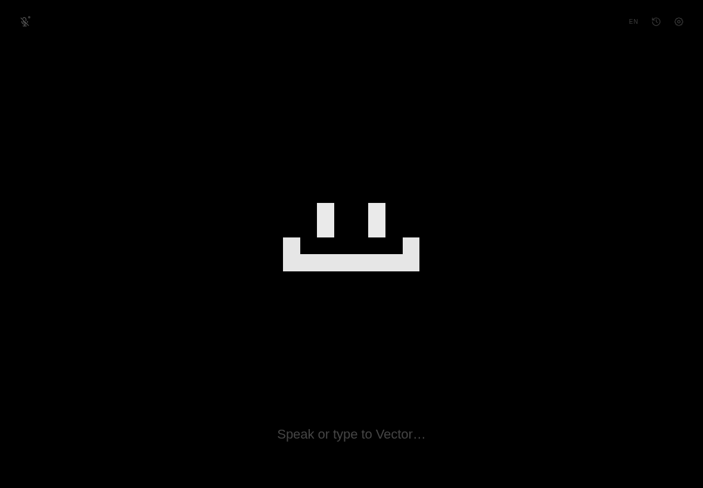

# Vector 2

[English](README.md) · **Русский**

**Vector** — локальный голосовой собеседник с маленьким анимированным пиксельным лицом. Он слушает вас через микрофон, распознаёт речь локально с помощью Whisper, получает ответы от локальной языковой модели через Ollama и реагирует мимикой. Он **никогда не говорит вслух** — никакого синтеза речи и голосовых ответов. Vector печатает.

Интерфейс намеренно устроен как один экран: лицо по центру, одна строка текста внизу и несколько почти незаметных элементов управления по углам. В комплекте три набора персонажей: **Vector** (оригинальный **спрайт 12×12**), **MOSS** (ЭЛТ-терминал 14×14) и **Lumen** (детальное лицо 16×16). Можно также собрать свой набор из любого скина и собственного системного промпта.



<sub>Экран по умолчанию: оригинальное лицо 12×12, одна строка, без панелей.</sub>

## Принципы дизайна

- **Одна сцена, одно лицо, одна строка.** Никаких постоянных панелей чата, HUD, индикаторов, статусов и панелей инструментов.
- **Персонаж — это интерфейс.** Состояние выражается лицом: слушает, думает, печатает, спит, проявляет эмоции.
- **Наборы персонажей, а не меню костюмов.** Набор задаёт имя, лицо, палитру и характер. Vector сохраняет оригинальный силуэт 12×12; MOSS и Lumen — отдельные персонажи, а не фильтры.
- **Спокойствие по умолчанию.** Плоский чёрный фон, белое лицо, янтарный акцент, тонкие границы. Частицы, сердечки, искры и свечение выключены, пока их не включат.
- **Постепенное раскрытие.** Настройки, история и консоль отладки появляются только тогда, когда их открывают.
- **Локально и приватно.** Звук и текст остаются на этом компьютере. Whisper, Silero VAD и Ollama работают локально. Сеть нужна только для однократной загрузки моделей.
- **Без TTS.** Единственные звуки — необязательные короткие синтезированные сигналы интерфейса (микрофон, отправка, получение, ошибка), но никогда не речь.

## Что понадобится

Вам не нужно быть программистом. Достаточно скопировать несколько команд в терминал — остальное сделает мастер первой настройки.

| Что | Зачем | Как проверить |
| --- | --- | --- |
| **Python 3.11–3.13** (рекомендуется 3.12) | Запускает локальный сервер Vector | `python3 --version` в macOS/Linux, `py --version` в Windows |
| **Ollama** | Запускает языковую модель на вашем компьютере | `ollama --version` |
| **Около 4 ГБ свободного места** | ~0,5 ГБ модель распознавания речи + ~2 ГБ языковая модель + пакеты Python | — |
| **Микрофон** | Vector слушает вас | — |
| **Chrome, Chromium, Brave или Edge** | Необязательно: открывает Vector в отдельном окне приложения | — |

В Python 3.14 может ещё не быть готовых пакетов для некоторых библиотек распознавания речи, поэтому по возможности установите **3.12**.

Вам **не** нужны PortAudio или другие нативные аудиобиблиотеки: микрофон захватывает браузер и отправляет на локальный сервер PCM с частотой 16 кГц.

---

## Установка по шагам

Вся установка занимает примерно **10–20 минут**, в основном это ожидание загрузок. Выполняйте шаги по порядку. Если команда не распознаётся, загляните в раздел [Если установка не удалась](#если-установка-не-удалась).

### Шаг 1 — Установите Python 3.12

**Windows**

1. Откройте <https://www.python.org/downloads/>.
2. Скачайте **Python 3.12.x** для Windows.
3. Запустите установщик. На первом экране поставьте галочку **«Add python.exe to PATH»**, затем нажмите **Install Now**.
4. Откройте терминал: нажмите `Win+R`, введите `cmd`, нажмите Enter.
5. Проверьте версию:

   ```bat
   py -3.12 --version
   ```

   Вы должны увидеть что-то вроде `Python 3.12.10`. Если отображается Python 3.14 или «not found», установите 3.12 по ссылке выше.

**macOS**

1. Скачайте установщик для macOS с <https://www.python.org/downloads/macos/> и запустите его, **или** установите через Homebrew:

   ```bash
   brew install python@3.12
   ```

2. Откройте **Terminal** (Программы → Утилиты → Терминал) и проверьте:

   ```bash
   python3.12 --version
   ```

**Linux (Ubuntu / Debian)**

```bash
sudo apt update
sudo apt install python3.12 python3.12-venv
python3.12 --version
```

В Fedora используйте `sudo dnf install python3.12`. В других дистрибутивах названия пакетов могут немного отличаться.

> **Проверка:** команда выводит `Python 3.12.x` (3.11 или 3.13 тоже подойдут).

### Шаг 2 — Установите и запустите Ollama

1. Скачайте Ollama с <https://ollama.com/download> и установите.
   - **Windows / macOS:** запустите установщик и один раз откройте приложение Ollama. Оно продолжит работать в фоне.
   - **Linux:** выполните команду установки с той же страницы или:

     ```bash
     curl -fsSL https://ollama.com/install.sh | sh
     ```

2. Закройте и снова откройте терминал, затем проверьте:

   ```bash
   ollama --version
   ```

3. Убедитесь, что Ollama запущена. В Windows/macOS значок Ollama должен быть в трее или строке меню. В Linux, если команда ниже не срабатывает, запустите вручную:

   ```bash
   ollama serve
   ```

   Оставьте это окно терминала открытым, пока пользуетесь Vector.

> **Проверка:** `ollama --version` выводит версию, а <http://127.0.0.1:11434> отвечает (нормально, если сама страница пустая или пишет «Ollama is running»).

### Шаг 3 — Скачайте Vector

Папка проекта должна оказаться на вашем компьютере. Выберите **один** вариант.

**Вариант A — через Git (рекомендуется, если Git уже установлен)**

```bash
git clone https://github.com/badretd/vector-beta.git
cd vector-beta
```

**Вариант B — без Git**

1. Откройте <https://github.com/badretd/vector-beta>.
2. Нажмите **Code → Download ZIP**.
3. Распакуйте архив.
4. Откройте терминал **внутри распакованной папки `vector-beta`** (в Windows: откройте папку, щёлкните правой кнопкой по пустому месту → «Открыть в терминале»; в macOS: правой кнопкой по папке → Services → «New Terminal at Folder»).

> **Проверка:** терминал находится в папке, где лежат `run.sh`, `requirements.txt` и каталог `vector`.

### Шаг 4 — Скачайте языковую модель

Это «мозг», с которым будет общаться Vector. Выполните:

```bash
ollama pull qwen2.5:3b
```

Загрузка занимает около **2 ГБ** и происходит только один раз. Будет показан индикатор прогресса.

Другие хорошие небольшие модели:

```bash
ollama pull llama3.2:3b
# или
ollama pull phi3:mini
```

По умолчанию используется `qwen2.5:3b`; позже модель можно сменить в **Настройки → Дополнительно**.

> **Проверка:** `ollama list` показывает только что скачанную модель.

### Шаг 5 — Запустите Vector

**macOS / Linux**

В папке проекта выполните:

```bash
./run.sh
```

При первом запуске создаётся отдельное окружение Python (`.venv`) и устанавливаются зависимости. Это занимает несколько минут. **Не закрывайте терминал, пока идёт установка.**

Если появляется `Permission denied`, один раз сделайте скрипт исполняемым и запустите снова:

```bash
chmod +x run.sh
./run.sh
```

**Windows**

`run.sh` — скрипт для macOS/Linux, поэтому в Windows выполните эти команды в папке проекта (в командной строке или PowerShell):

```bat
py -3.12 -m venv .venv
.venv\Scripts\activate
pip install -r requirements.txt
python -m vector
```

При первом запуске установятся зависимости — это займёт несколько минут. Если PowerShell отказывается активировать окружение, используйте **командную строку (`cmd`)**.

**Что должно произойти:** через некоторое время в терминале появится заставка, а в браузере откроется <http://127.0.0.1:8765/>. Если окно не открылось, откройте этот адрес вручную в Chrome.

**Ручной способ** (любая ОС, если не хотите использовать `run.sh`):

```bash
python3.12 -m venv .venv
source .venv/bin/activate       # Windows: .venv\Scripts\activate
pip install -r requirements.txt
python -m vector
```

Чтобы остановить Vector, вернитесь в терминал и нажмите `Ctrl+C`. Чтобы запустить снова, повторите ту же команду — зависимости уже установлены.

### Шаг 6 — Пройдите мастер первой настройки

При первом запуске Vector показывает короткий экран настройки:

1. **Язык** — выберите English или Русский.
2. **Проверка готовности** — Vector проверяет три вещи:
   - **Локальная LLM** — запущена ли Ollama и отвечает ли она;
   - **Распознавание речи** — загружается ли Whisper;
   - **Микрофон** — видит ли браузер устройство ввода.
3. **Кем мне быть?** — выберите **Vector**, **MOSS** или **Lumen**, либо создайте **свой набор** с собственным именем, скином и системным промптом. Затем выберите тему комнаты: **Mono**, **Mint** или **Paper**.

Модель распознавания речи скачивается при первом использовании в `data/models/whisper/`. Модель `small` по умолчанию занимает около **466 МБ**, поэтому первая проверка может занять несколько минут и требует подключения к интернету. Прогресс виден на экране проверки и в консоли отладки.

Если проверка LLM не проходит, а вам просто хочется посмотреть интерфейс, нажмите **«explore with the offline demo»** — для демо Ollama не нужна.

Когда проверка микрофона станет зелёной, разрешите браузеру доступ к микрофону, если он спросит. Всё обрабатывается локально.

> **Готово.** Щёлкните по ответу, чтобы закрыть его, нажмите `F9` или щёлкните по фону, чтобы начать слушать, и просто говорите или печатайте.

### Другие параметры запуска

```bash
python -m vector --no-browser          # только вывести URL
python -m vector --tab                 # открыть обычную вкладку браузера
python -m vector --port 9000
python -m vector --demo                # офлайн-демо без Ollama
python -m vector --data-dir ./profile  # отдельные настройки и история
```

### Обновление Vector

```bash
git pull
./run.sh
```

Если после обновления запуск не удался, переустановите зависимости:

```bash
# macOS / Linux
.venv/bin/python -m pip install -r requirements.txt

# Windows
.venv\Scripts\python -m pip install -r requirements.txt
```

## Управление

| Действие | Как сделать |
| --- | --- |
| Включить / выключить микрофон | `F9` или щёлкнуть по фону |
| Отправить набранный текст | `Enter` |
| Новая строка | `Shift+Enter` |
| Отправить накопленную речь | `F2` (настраивается) |
| Показать / скрыть историю диалога | `Ctrl+H` |
| Показать / скрыть консоль отладки | `Ctrl+Shift+D` |
| Закрыть окно / отменить ответ | `Esc` |
| Закрыть ответ | Щёлкнуть по ответу |
| Ткнуть Vector | Щёлкнуть по лицу |
| Изменить размер персонажа | Прокрутка |
| Изменить масштаб всего интерфейса | `Ctrl+прокрутка` |

Селектор режима исчезает в состоянии покоя. Наведите курсор на область ввода, чтобы увидеть `silence · hotkey · auto`, или измените режим в **Настройки → Собеседник**.

## Режимы очерёдности

- **Тишина** (по умолчанию) — Silero VAD определяет речь и её окончание. После `asr.silence_ms` тишины (по умолчанию 900 мс) фраза распознаётся и отправляется.
- **Горячая клавиша** — речь распознаётся и накапливается. Ничего не отправляется, пока вы не нажмёте `F2` (или Enter при пустом поле ввода).
- **Авто** — каждая фраза оценивается объяснимым алгоритмом (вопросы, прямое обращение, приветствия, просьбы, ожидающий вопрос от Vector, пользовательские ключевые слова). Если оценка достигает порога (по умолчанию 3), буфер отправляется. Иначе он удерживается, а таймер принудительной отправки в итоге всё равно его отправит.

Каждая оценка и её причина видны в консоли отладки.

## Протокол эмоций

Системный промпт Vector просит модель начинать предложения с одного тега из списка:

`[neutral] [happy] [excited] [curious] [thinking] [sad] [surprised] [confused] [sleepy] [angry] [embarrassed] [love] [proud] [scared] [bored] [wink] [laugh] [glitch]`

Примеры:

```text
[curious] What is rain made of? [happy] I want to taste it.
```

Парсер принимает `[happy]`, `<happy>`, `*happy*`, `(happy)`, `[emotion: happy]` и псевдонимы вроде `joy`, `laughs`, `shy`, `wow`, `error`. Это потоковый парсер, поэтому тег, разделённый между двумя фрагментами ответа LLM, никогда не попадает в чат. Если модель забыла теги, небольшая эвристика по тональности и словарю выбирает эмоцию сама.

У лица есть и внутренние состояния (`listening`, `thinking`, `speaking`, `sleeping`), которые не запрашиваются у модели.

## Наборы персонажей

Набор персонажа задаёт имя, лицо, палитру по умолчанию и системный промпт. В комплекте три набора:

| Набор | Скин | Характер |
| --- | --- | --- |
| **Vector** | Оригинальный 12×12 | Игривая любопытная программка из оригинального спрайта |
| **MOSS** | ЭЛТ 14×14 | Скрипучий терминал с квадратными фосфорными глазами, тусклой рамкой и светодиодом |
| **Lumen** | Детальный 16×16 | Мягкое лицо с бровями, щеками, созвездиями и спокойной улыбкой |

Все три используют одну машину состояний эмоций и масштабирование методом ближайшего соседа. Они поддерживают:

- Случайное моргание и иногда двойное моргание
- Глаза, следящие за указателем, и случайные саккады в покое
- Дыхание и очень лёгкое покачивание
- Движение рта, пока поступает ответ
- Улыбку, нахмуренные брови, рот набок, открытый рот и рот буквой «О»
- Сон (закрытые глаза, замедленное дыхание)
- Плавные переходы между выражениями

**Свой набор** может использовать любой из трёх скинов, собственное имя и базовый системный промпт. Правила эмоций и стиля всё равно добавляются автоматически, иначе лицо перестанет реагировать.

Пользователям со старыми настройками один раз показывается выбор набора, чтобы старый персонаж не потерялся незаметно. `terminal` превращается в MOSS, `oracle` — в Lumen, а удалённые `kitten`/`gremlin` — в Vector.

**Лаборатория лица** (`Настройки → Персонаж → Открыть лабораторию лица` или `/lab.html`) показывает каждый скин, эмоцию, состояние, палитру, размер и переключатели анимации. Это самый быстрый способ настроить персонажа.

В лаборатории также есть **умное разделение** с режимами `inset`, `gap`, `trim` и `off` и подсветка столкновений. Режим `inset` по умолчанию слегка поджимает край рта примерно на два экранных пикселя, поэтому он не перекрывает глаза; глаза сохраняют все пиксели. `gap` и `trim` остаются для сравнения.

## Настройки

Всё хранится в `data/settings.json` и сохраняется автоматически.

- **Голос** — язык интерфейса, модель Whisper, язык распознавания, микрофон, тишина перед отправкой, чувствительность микрофона, промежуточное распознавание.
- **Персонаж** — набор персонажа, поля своего набора, тема комнаты, палитра лица, размер, умное разделение, следование за указателем, моргание, дыхание, частицы, антенна, уменьшенное движение, цвета, лаборатория лица.
- **Собеседник** — имя, язык ответов, длина ответов, режим очерёдности, ненавязчивые напоминания, настроение, факты памяти.
- **Дополнительно** — URL и модель Ollama, температура, контекст, максимум токенов, устройство и точность ASR, уровень логирования, офлайн-демо, импорт/экспорт/сброс.

Темы: **Mono** (по умолчанию), **Mint** и **Paper**. Палитра лица независима, поэтому белое лицо можно поместить в мятную комнату, а тёмное — в бумажную.

## Архитектура

```
vector-beta/
├── vector/                 бэкенд на Python
│   ├── __main__.py         запуск, окно браузера, флаги CLI
│   ├── server.py           FastAPI, WebSocket-хаб, REST API, логирование
│   ├── config.py           значения по умолчанию, валидация, атомарное хранилище настроек
│   ├── characters.py       встроенные наборы, скины, миграция старых настроек
│   ├── asr.py              faster-whisper, Silero VAD, определение конца фразы, partials
│   ├── dialogue.py         менеджер реплик, судья автоотправки, память, настроение
│   ├── llm.py              асинхронный потоковый клиент Ollama + офлайн-демо
│   ├── emotions.py         реестр эмоций, потоковый парсер тегов
│   ├── prompts.py          компактные промпты личности
│   └── ...
├── web/                    фронтенд без сборки
│   ├── index.html          одна сцена
│   ├── lab.html            лаборатория лица
│   ├── css/app.css         mono/mint/paper, панели, отладка
│   ├── js/main.js          состояние, сокет, горячие клавиши, первичная настройка
│   ├── js/character.js     процедурный пиксельный персонаж + анимация
│   ├── js/audio.js         захват микрофона + ресемплер до 16 кГц
│   ├── js/pcm-worklet.js   ресемплер AudioWorklet
│   ├── js/settings.js      генерируемая панель настроек
│   ├── js/debug.js         консоль отладки
│   ├── js/i18n.js          EN/RU
│   └── locales/
├── examples/               оригинальные спрайты 12×12
├── tests/                  тесты pytest
├── requirements.txt
├── run.sh
└── data/                   создаётся во время работы
```

Аудиопуть: браузер `getUserMedia` → AudioWorklet ресемплирует в 16 кГц моно float32 → бинарный WebSocket → определение конца фразы Silero VAD → faster-whisper → менеджер реплик → поток NDJSON от Ollama → парсер эмоций → события WebSocket → лицо и чат.

### Замечания о производительности

- Отдельные исходящие очереди для каждого клиента: один медленный браузер не может затормозить менеджер реплик.
- Фрагменты ответа ассистента объединяются (~40 мс / 56 символов) перед рассылкой.
- Фронтенд обновляет один текстовый узел в `requestAnimationFrame`; DOM сообщения не перестраивается на каждый токен.
- Ресемплинг аудио выполняется в AudioWorklet, а не в основном потоке.
- Canvas приостанавливается, когда вкладка скрыта.
- Промежуточные распознавания троттлятся; только финальный текст управляет менеджером реплик.
- Персонаж использует логическую сетку 12×12, 14×14 или 16×16, поэтому отрисовка остаётся дешёвой.

## Консоль отладки

Нажмите `Ctrl+Shift+D` (или щёлкните по значку жука). Вкладки:

- **logs** — живые логи сервера.
- **chat** — полная сохранённая история с ролями, временем и тегами эмоций.
- **events** — сырой трафик WebSocket.
- **state** — статус, здоровье, настройки, информация о сервере.
- **asr** — модель/устройство, последняя транскрипция, последний partial, конфигурация ASR.
- **emotions** — сетка эмоций и временная шкала реакций.
- **prompt** — точный системный промпт, который сейчас отправляется модели.

Консоль умеет копировать текущую вкладку и скачивать JSON-снимок отладки. Логи также пишутся в `data/logs/vector.log`.

## Приватность и отсутствие синтеза речи

- Аудио с микрофона отправляется только на локальный сервер по `127.0.0.1`.
- Whisper, Silero VAD и Ollama работают локально.
- Настройки, история, факты и логи находятся в `data/`.
- Первая загрузка модели обращается к Hugging Face; после неё вывод работает офлайн.
- Сервер по умолчанию слушает `127.0.0.1`. Не открывайте его в сеть без добавления аутентификации.
- В коде нет пути TTS. Единственные звуки — необязательные короткие синтезированные сигналы интерфейса.

## Тесты

```bash
source .venv/bin/activate
pip install -r requirements-dev.txt
pytest -q
```

Набор тестов покрывает потоковый парсер эмоций, псевдонимы, оценку автоотправки на обоих языках, слияние и валидацию конфигурации, извлечение памяти, компактность промптов, определение конца фразы ASR с фиктивным движком и режимы диалога. Установите `VECTOR_TEST_ASR=1`, чтобы запустить реальный тест загрузки Whisper.

## Если установка не удалась

**`python3` / `python` / `py` не распознаётся** — Python не установлен или не добавлен в PATH. Переустановите Python 3.12 и в Windows поставьте галочку «Add python.exe to PATH». В macOS/Linux вызывайте его как `python3.12`.

**`./run.sh: Permission denied`** — один раз выполните `chmod +x run.sh` и повторите запуск.

**`ollama: command not found`** — Ollama не установлена или терминал был открыт до установки. Закройте и снова откройте терминал. При необходимости перезагрузите компьютер.

**`Ollama is not reachable`** — убедитесь, что Ollama запущена (в Linux — `ollama serve`), и проверьте:

```bash
curl http://127.0.0.1:11434/api/tags
```

Также проверьте, что модель из шага 4 скачана, или включите **Офлайн-демо** в разделе «Дополнительно».

**Браузер не открывается** — откройте <http://127.0.0.1:8765/> вручную. Терминал должен оставаться открытым; если его закрыть, Vector остановится.

**`No module named vector`** — команда выполнена вне папки проекта. Перейдите (`cd`) в папку, где лежит `run.sh`, и повторите.

**Загрузка идёт очень долго** — при первом запуске скачиваются пакеты Python, языковая модель (~2 ГБ) и модель распознавания речи (~466 МБ). Стабильное соединение нужно только для этих однократных загрузок. После них Vector работает офлайн.

**Проверка микрофона красная** — разрешите доступ к микрофону в браузере, закройте другие приложения, которые могут занимать микрофон, и используйте адрес `http://127.0.0.1:8765/`, а не сетевой адрес.

## Решение проблем

**«Speech model failed to load»** — проверьте `data/logs/vector.log` и вкладку ASR в консоли отладки. Ввод текстом при этом работает. Попробуйте `device: cpu`, `compute_type: int8` или модель поменьше. Для первой загрузки нужен доступ в интернет.

**Нет микрофона** — используйте `http://127.0.0.1` (безопасный контекст), разрешите доступ к микрофону в браузере и проверьте, не занято ли устройство другим приложением. Режим окна приложения Chrome работает; Firefox лучше использовать в обычной вкладке.

**GPU не используется** — статус ASR показывает `cpu`. Библиотеки CUDA отсутствуют или проверка не удалась; установите `nvidia-cublas-cu12` / `nvidia-cudnn-cu12`. Модель `small` на CPU всё равно пригодна к использованию.

**Ответы слишком длинные или медленные** — уменьшите **максимум токенов ответа**, используйте `qwen2.5:3b`/`llama3.2:3b`, сократите число ходов истории или увеличьте таймаут.

**Лицо выглядит застывшим** — проверьте **Уменьшенное движение**, **Моргание** и **Дыхание** в разделе «Настройки → Персонаж». Лицо использует `requestAnimationFrame`; в фоновой вкладке анимация замедляется.

**Лицо слишком суровое** — по умолчанию используется оригинальный белый спрайт Vector 12×12. Переключитесь на **Lumen** в разделе «Настройки → Персонаж», чтобы получить детальное лицо 16×16, или на **MOSS** для вида ЭЛТ-терминала 14×14.

## Лицензия

MIT. См. `LICENSE`.
